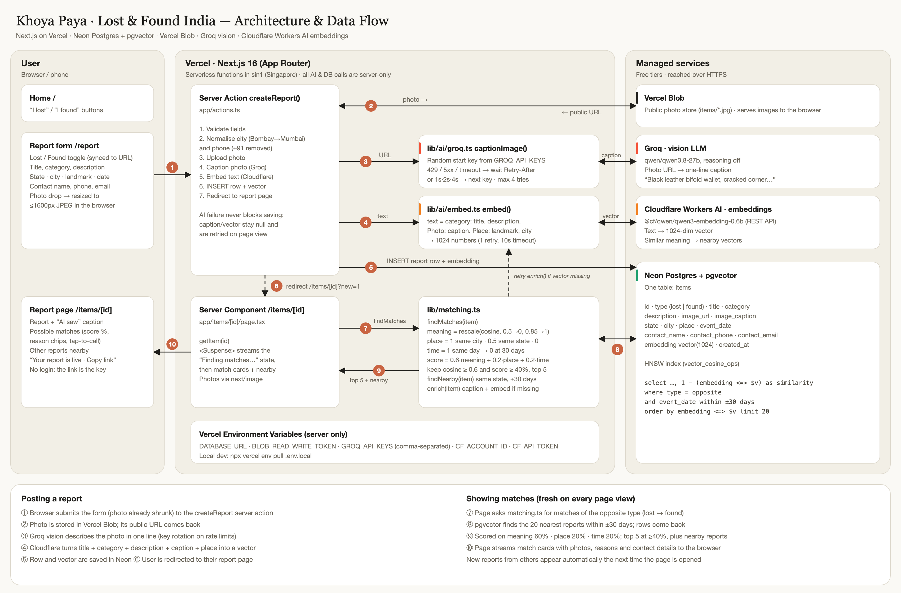

# Khoya Paya · AI-Powered Pan-India Lost & Found

Report something you lost or found anywhere in India. AI compares your report with every
opposite report (lost ↔ found) by **object, description, photo, place and date**, and shows the
likely matches with the other person's contact details.

**Live:** https://lostandfound-sepia.vercel.app

INT257 project by **Aditya Kumar (12409497)** and **Sanya Manchanda (12408319)**.



## How it works

1. **Post a report:** title, category, description, optional photo, state, city, landmark, date and contact.
2. **Photo → words:** a Groq vision model describes the photo ("black leather bifold wallet, cracked corner").
3. **Words → numbers:** Cloudflare Workers AI turns category + title + description + caption + place into a 1024-dim vector, stored in Neon Postgres (pgvector).
4. **Matching** (fresh on every visit to a report page):
   - nearest opposite-type reports within ±30 days (pgvector cosine search)
   - `score = 0.6 × meaning + 0.2 × place + 0.2 × time`
   - top 5 at ≥ 40%, plus "Other reports nearby" from the same state

## Tech stack

| Part | Choice |
|---|---|
| App | Next.js 16 (App Router, Server Actions) + TypeScript, Tailwind CSS v4, Motion |
| Database | Neon Postgres + pgvector |
| Photos | Vercel Blob |
| Photo captions | Groq `qwen/qwen3.8-27b` (vision), key rotation on 429/5xx |
| Embeddings | Cloudflare Workers AI `@cf/qwen/qwen3-embedding-0.6b` |
| Hosting | Vercel (region `sin1`) |

## Run locally

```bash
npm install
npx vercel link            # link to the Vercel project
npx vercel env pull .env.local
node --env-file=.env.local scripts/migrate.mjs   # create the table (first time)
node --env-file=.env.local scripts/seed.mjs      # optional demo data (71 reports)
npm run dev                                      # http://localhost:3000
```

Environment variables are listed in [.env.example](.env.example).

## Project layout

```
src/app/page.tsx              Home
src/app/report/page.tsx       Report form
src/app/items/[id]/page.tsx   Report + matches + nearby
src/app/actions.ts            createReport server action
src/lib/ai/groq.ts            Photo caption with key rotation
src/lib/ai/embed.ts           Cloudflare embeddings
src/lib/matching.ts           findMatches, findNearby, scoring
src/lib/db.ts, blob.ts        Neon client, Blob upload
db/schema.sql                 Table + indexes
scripts/                      migrate, seed, demo photo list
docs/                         Architecture diagram, INT257 submission sheet
```

Demo photos are CC0 / public-domain images from Openverse; sources are in `scripts/demo-photos.json`.
